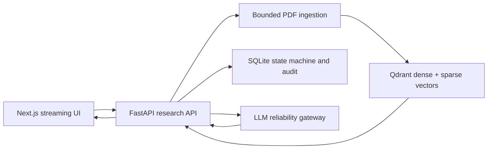

# Cited Research Workbench

A bounded PDF research product that treats citations, approvals, streaming state, and audit evidence as first-class contracts. The repository combines a FastAPI backend, a Next.js/TypeScript interface, durable SQLite workflow state, and an optional Qdrant hybrid-retrieval adapter.

This is a clean-room portfolio implementation. Tests and demo content are synthetic; no personal resume, employer document, client corpus, or provider secret is included.

## Architecture



## Product contracts

- Digital-text PDFs only: at most 25 MB and 200 pages; encrypted, malformed, image-only, and empty PDFs fail explicitly.
- Page, document, source hash, and chunk identity survive ingestion and retrieval.
- Dense and sparse retrieval are fused with reciprocal-rank fusion, then reranked over the bounded candidate set.
- `CitedAnswer` rejects any non-abstaining claim without a page-specific citation.
- Research runs persist as `draft → awaiting_approval → executing → completed | failed | cancelled`.
- Cost above USD 0.10, external network access, and exports require a persisted approval.
- Persisted approvals expire after the configured TTL and return the run to `awaiting_approval`.
- SSE audit events have IDs so a client can resume without duplicating UI state.
- The browser uses native `fetch` and `EventSource`; `axios` is intentionally absent.

## Run

Backend:

```bash
cd backend
uv sync --extra dev
uv run uvicorn research_workbench.main:app --reload --port 8090
```

Frontend:

```bash
cd frontend
npm install
npm run dev
```

Full topology:

```bash
docker compose up --build
```

The backend uses deterministic in-memory retrieval unless `WORKBENCH_QDRANT_URL` is set. Generation is deterministic unless both gateway URL and API key are configured. This keeps the default demo reproducible and makes external dependencies explicit.

## Verify

```bash
cd backend && uv run ruff check . && uv run mypy && uv run pytest
cd frontend && npm run verify
docker compose config --quiet
```

Tests cover page preservation, real Qdrant dense/sparse fusion, reranker-outage fallback, malformed/image-only input, unsupported-question abstention, poisoned-document handling, approval bypass/replay/expiry, append-only audit hashes, event resumption, and UI event deduplication. These checks do not establish answer quality on arbitrary corpora, external reranker/model availability, or production capacity.

See the [page-citation ADR](backend/docs/adr/0001-page-citations-as-data.md) and [threat model](docs/THREAT-MODEL.md).
